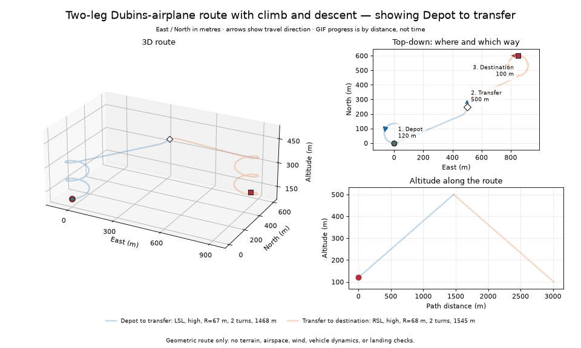
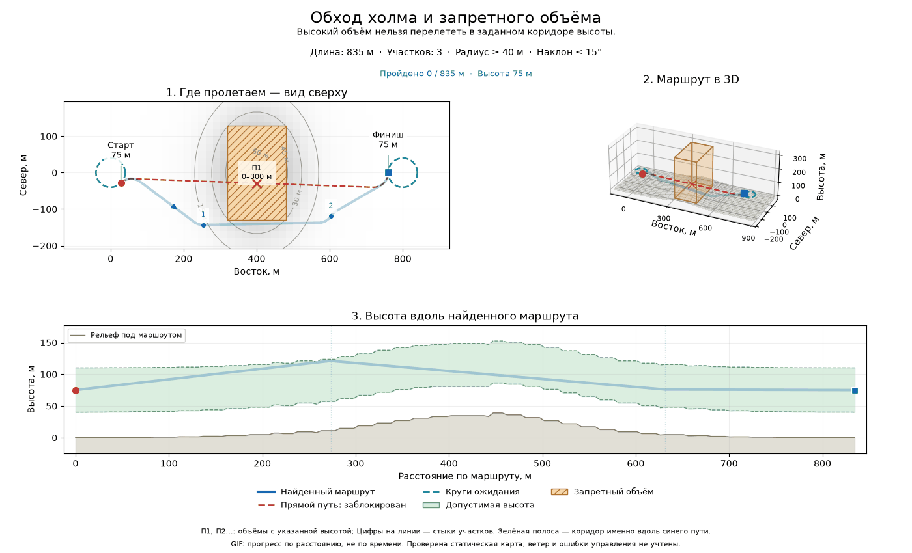

# 3D Dubins for aerial logistics

A small **C++17 planner with a Python interface** for **Owen, Beard & McLain (2014)** trajectories and **Lim et al. (2024)** terrain-aware planning between safe loiter circles. A readable Python reference remains available; plotting is optional.



## Run

From this folder, build the fast backend once (Python 3.10+):

```bash
# Use an installed GCC, Clang, MSVC Developer shell or Zig compiler.
# If none is available, install a portable compiler:
python -m pip install ziglang
python -m dubins_airplane.build_native
```

Then run the existing examples:

```bash
python -m examples.example
python -m unittest discover -s tests -v
```

For plots and GIF generation:

```bash
python -m pip install -r requirements.txt
python -m examples.example --plot
python -m examples.example --save-visuals
```

The examples write CSV routes to `outputs/`. Saved PNGs and GIFs are in `visuals/`.

For interactive **Rerun** visualization (3D, top view, aircraft animation and altitude profile):

```bash
python -m pip install -r rerun_scripts/requirements.txt
python -m rerun_scripts.dubins --scenario buildings --backend cpp
python -m rerun_scripts.dubins --scenario all --backend cpp --save
python -m rerun outputs/rerun/ridge.rrd
```

The launcher requires C++ by default: the Python code exports and visualizes results, not the search loop. See [Rerun scenarios and controls](rerun_scripts/README.md#сценарии-dubins-с-c-бэкендом).

Terrain scenarios use **10 × 10 m cells**, preserving the 1180 × 800 m map extent
(1180 × 1000 m for `ridge`). Rerun colors terrain cells by elevation in both views,
with a shared numeric legend. A dimension line measures the actual start-to-finish
distance in plan; route length and the distance between loiter centers are shown separately.
The yellow aircraft marker has a live altitude/readout above the map.

Two harder scenarios at the same map scale: **slalom** (three alternating barrier gaps)
and **mountain_pass** (two peaks, two barriers and a climb to a plateau).
[Slalom GIF](visuals/slalom.gif) · [Mountain-pass GIF](visuals/mountain_pass.gif).
These are captures of the actual Rerun Viewer, with C++ planning, seed 7 and 600 iterations:

```bash
python -m rerun_scripts.dubins --scenario slalom --backend cpp --gif
python -m rerun_scripts.dubins --scenario mountain_pass --backend cpp --gif
```

After building, the examples and Python API automatically use C++. No compiler or extra runtime package is needed to run the built library. Without a library, they fall back to the standard-library Python reference. Check the active backend with `python -c "from dubins_airplane import backend_name; print(backend_name())"`.

Set `DUBINS_BACKEND=cpp` to require C++ or `DUBINS_BACKEND=python` to force the reference. In PowerShell: `$env:DUBINS_BACKEND='cpp'`; in bash: `export DUBINS_BACKEND=cpp`. Rebuild after changing native sources, using the target platform/architecture. For a **C++-only executable** and CMake instructions, see [native/README.md](native/README.md).

## Multiple airborne airplanes

The [scenario benchmark](docs/BENCHMARK.md) runs **144 different tasks**:
six obstacle/terrain topologies × three **shared group missions** ×
**ascent/descent of the whole swarm** × **2, 4, 5, 8 agents**.
Each task runs once, with the existing **decentralized spatial replanner enabled**:
initial routes → exchange → time-aware RRT* geometry changes → safety audit.
No 30-seed series or comparison of communication profiles.

[Current faster C++ results: 0 ms delivery, no losses/duplicates](outputs/benchmark_swarm_1km_fast/report/README.md)
· [Current metrics, 16:9](outputs/benchmark_swarm_1km_fast/report/metrics.png).

[Comparison with benchmark_swarm_1km_bidirectional, 16:9](outputs/benchmark_swarm_1km_fast/report/comparison_bidirectional.png)
· [SVG](outputs/benchmark_swarm_1km_fast/report/comparison_bidirectional.svg)
· [Settings and median values](outputs/benchmark_swarm_1km_fast/report/comparison_bidirectional.md).
The 144 mission inputs match; network and stopping settings differ between runs.
Regenerate from saved measurements with `python -m examples.compare_benchmarks`.

The instant-delivery slide includes three panels: full mission time, path length and
all planning calls per agent (`P/N`). [All calls alone](outputs/benchmark_swarm_1km_fast/report/plannings.png)
· [Traffic replans alone](outputs/benchmark_swarm_1km_fast/report/replans.png)
· [Derived summary JSON](outputs/benchmark_swarm_1km_fast/report/summary.json).
R counts all searches with peer reservations, including unsuccessful ones;
initial searches and static no-path retries are excluded. The table reports
both median and mean R/N across missions.
[Scatter plot: all planning calls vs time per agent](outputs/benchmark_swarm_1km_fast/report/planning_vs_time.png)
· [Vector SVG](outputs/benchmark_swarm_1km_fast/report/planning_vs_time.svg).
Each dot is one mission, X = P/N and Y = T/N in milliseconds; color identifies fleet size.
P includes initial searches, static retries and traffic replanning calls, including failures.
[Time per planning call, 16:9](outputs/benchmark_swarm_1km_fast/report/time_per_planning.png)
· [Vector SVG](outputs/benchmark_swarm_1km_fast/report/time_per_planning.svg).
The left panel shows `(T/N)/(P/N) = T/P`, the group wall time per call.
The right panel shows `sum(call.elapsed_ms)/P`, the mean measured local-call duration.
Each observation is formed within one mission before taking medians by fleet size;
parallel initial searches explain why the two measurements differ.
[Individual RRT* call durations by role and iteration cap](outputs/benchmark_swarm_1km_fast/report/planning_call_times.png)
· [Vector SVG](outputs/benchmark_swarm_1km_fast/report/planning_call_times.svg).
The 600- and 3000-iteration caps have separate panels and scales. Each point is
one measured local call; initial searches, static retries and traffic replans
are separate boxes, including searches that did not find a path. All metric
figures use 16:9 PNG (3840×2160) and SVG, with time in milliseconds.
[Why some calls take seconds: measured breakdown and native profile](outputs/profile_20261028/README.md).
[Actual C++ changes and paired speed measurements](outputs/faster_20261028/README.md).
The [previous instant-delivery run](outputs/benchmark_swarm_1km_instant/report/README.md)
and [previous normal-network run](outputs/benchmark_swarm_1km_adaptive/report/README.md) are archived separately.
Missions: a compact team transfer, gathering dispersed agents into one destination
region, and changing the team's endpoint arrangement during a common transfer.
All agents fly at 20 m/s toward one shared goal region, with separate safe terminal
circles. Each mission sends the WHOLE swarm uphill (150 → 1150 m) or downhill
(1150 → 150 m). There are no opposing subgroups within one mission. Gathering
stays gathering on descent; paths are planned afresh on the same map, not reversed.
Fixed formation/cohesion during flight is not required.
Both primary metrics are divided by fleet size: **T/N** (ms/agent) and
**sum(length)/N** (km/agent). T/N is an amortised group cost, not one RRT* call's latency.
Each ordinary search has a cap of **600 RRT* iterations**; after a no-path search, that
agent has a cap of **3000 iterations**, up to eight local calls in total. Every call is
included in the measured time. The benchmark allows a 100 s simulated agreement
window before departure; this is not a real-time sleep. Core API defaults remain unchanged.
The benchmark and decentralized example launchers now default to **adaptive stopping**:
`--relative-gap 0.03` returns a continuously checked local route once its length is
within 3% of a physical lower bound for the discrete endpoints. Otherwise search
continues to the cap. This is a local criterion, not a bound on joint mission quality.
Use `--relative-gap 0` for the fixed-budget reference, or pass `relative_gap=0.03`
to `simulate_decentralized` / `plan_safe_rrt_star` / `plan_safe_rrt_star_traffic`.
The planning workspace is **1 × 1 × 1 km**, with 10 m cells:
x = 0–1000 m, y = −500–500 m, z = 150–1150 m. Every flight changes altitude
by 1000 m; the 40 m turn radius and 15° climb limit are unchanged, so routes
may need several kilometres of helical flight inside this volume.
The old large mountain example remains separate from this benchmark.

```bash
# Full suite: measure first, draw charts only after all tasks finish.
python -m examples.benchmark_scenarios --network ideal --output outputs/benchmark_swarm_1km_fast/results.json
# A selected paired scenario (whole-swarm ascent and descent):
python -m examples.benchmark_scenarios --topology mountains --scenario reconfigure --agents 5 --output outputs/benchmark_selected/results.json
# Only whole-swarm descents:
python -m examples.benchmark_scenarios --direction descent --output outputs/benchmark_descents/results.json
# Regenerate the report without planning:
python -m examples.benchmark_scenarios --plot-only outputs/benchmark_swarm_1km_fast/results.json
# Update charts/tables only, keeping the existing Rerun captures:
python -m examples.benchmark_scenarios --plot-only outputs/benchmark_swarm_1km_fast/results.json --metrics-only
# Re-render only the actual Rerun oblique views, without planning:
python -m examples.render_benchmark_routes outputs/benchmark_swarm_1km_fast/results.json
```

The `report/` directory contains `routes.png` (both mission directions),
`routes_ascent.png`, `routes_descent.png`, and the original Rerun `.rrd` files.
Metric box plots pool ascent and descent: one box per fleet size,
36 missions for each of 2, 4, 5 and 8 agents. `metrics.png` combines the metrics
in one slide-ready 16:9 layout; no old/new comparison appears on these charts.
The [fixed-budget C++ run](outputs/benchmark_swarm_1km_optimized/report/README.md),
the [previous full run](outputs/benchmark_swarm_1km_bidirectional/report/README.md)
and the [separate paired optimization checks](outputs/optimization_20261027/README.md)
remain archived; neither is mixed into the current measurements.

Fleet examples now default to **decentralized coordination in a simulation**.
Each agent runs its own C++ Owen/RRT* search; initial searches execute in parallel.
Agents exchange versioned proposals, acknowledgements and immutable commits over
a simulated network with delay, loss, duplicates and reordering. The transport
does not choose trajectories. IDs establish the same priority locally on each
agent. `plan_fleet` remains available as a centralized reference
(`--coordination centralized`).

The centralized reference retains each airplane's full-budget Owen/RRT* route and
resolves conflicts by **complete laps on its start circle**. Both modes keep all airplanes
exist from `t=0`; after arrival they keep flying on their separate goal circles.
Constant per-airplane speeds and a common clock are used. Continuous 3D distance
checks include waiting, travel and terminal loitering; the checker runs in C++
when that backend is selected.

Rebuild the native library once after this update, then run from this folder:

```bash
python -m dubins_airplane.build_native
# Plan and export timed CSVs without a viewer:
python -m examples.example_fleet --scenario hills --backend cpp
# Interactive Rerun (requires rerun_scripts/requirements.txt):
python -m rerun_scripts.fleet --scenario hills --backend cpp
python -m rerun_scripts.fleet --scenario mountain_pass --backend cpp --gif
# Exercise the peer protocol with more lost packets:
python -m examples.example_fleet --scenario hills --network-loss 0.3 --planning-window 10
# Compare the previous centralized version:
python -m examples.example_fleet --scenario hills --coordination centralized
```

Seven scenarios: three airplanes over hills/onto a plateau (`hills`, the default),
three through the existing mountain pass with two peaks and barriers
(`mountain_pass`), and the previous flat-ground `crossing`, `three_way` and
`bottleneck` cases, plus `altitude_conflict_1km` and `mountain_exchange_5` below.
The original maps retain 10 × 10 m cells and 1180 × 800 m extent; the two-airplane
1 km altitude case uses 6400 × 1600 m, and the five-airplane case 6400 × 2400 m.
Terrain is part of collision checking, not just a visualization mesh; safe
loiter altitudes are selected from the terrain flight band. In the new examples,
airplanes climb/descend about 75 m and 93 m between their start/goal circles.
Outputs are under `outputs/fleet/`; decentralized recordings/CSVs have an
`_decentralized` suffix and include the message trace. Rerun's info panel has an
"Обмен сообщениями" tab. [Decentralized hills GIF](visuals/fleet_hills_decentralized.gif) ·
[Decentralized mountain-pass GIF](visuals/fleet_mountain_pass_decentralized.gif) ·
[Centralized hills GIF](visuals/fleet_hills.gif) ·
[Mountain-pass GIF](visuals/fleet_mountain_pass.gif) ·
[Crossing GIF](visuals/fleet_crossing.gif) · [Barrier GIF](visuals/fleet_bottleneck.gif).

The network panel animates individual delayed packets on the **same simulation
clock as airplane motion**. It shows local agreement states, losses and retries.
Routes are faded previews until the agent commits; unconfirmed agents keep
their initial circles. Fleet GIFs slow the negotiation phase before accelerating
the flight; the on-screen `t` remains simulation time, not playback time.
[Normal network GIF](visuals/fleet_network_normal.gif) ·
[Slow-network timeout GIF](visuals/fleet_network_timeout.gif).

```bash
# Default: 0–150 ms packet delay, 10% loss, 5-second negotiation window.
python -m rerun_scripts.fleet --scenario hills --backend cpp
# Slow, but successful: fixed 500 ms delivery; allow a 10-second window.
python -m rerun_scripts.fleet --scenario hills --network-min-delay-ms 500 --network-delay-ms 500 --network-loss 0 --planning-window 10 --name hills_network_slow
# Timeout: fixed 1500 ms delivery; keep the default 5-second window.
python -m rerun_scripts.fleet --scenario hills --network-min-delay-ms 1500 --network-delay-ms 1500 --network-loss 0 --name hills_network_timeout
# Save a GIF of only the negotiation phase (all agents still circling).
python -m rerun_scripts.fleet --scenario hills --gif-network-only --name hills_network_negotiation
```

The visualization also exports audited **partial reservations after a timeout**:
already committed flights continue; other agents circle indefinitely. The
planning API and CSV example still raise `DecentralizedPlanningError`; inspect
its `result` for diagnostic metrics/packet traces. A longer network delay need
not change flight geometry or departure times if agreement fits the preallocated
window. This is simulated transport, not real networking or an autopilot.

### Actual initial conflict with a 1 km altitude change

```bash
python -m rerun_scripts.fleet --scenario altitude_conflict_1km --backend cpp
# Save both the coordinated mission and a clearly marked UNSAFE comparison:
python -m rerun_scripts.fleet --scenario altitude_conflict_1km --backend cpp --compare-initial --gif
```

Two opposite-direction airplanes climb 120 → 1120 m and descend 1120 → 120 m.
Terrain also rises by exactly 1000 m; its slope remains flyable at the 15° climb
limit. The map is 6.4 × 1.6 km, still sampled in 10 × 10 m cells. With default
seed 7 and 600 iterations, original independent proposals approach to about
**4.29 m** near t=165.68 s: a continuous distance check rejects them at the
required 40 m separation. This is a real time-and-height conflict, not just an
XY intersection. B now **rebuilds spatial geometry using A's received timed route**:
three Dubins legs replace the original single connection. Departure stays exactly
17.28 s: **no extra conflict-resolution laps or time shifts**. Closest approach
becomes about **45.00 m**. A uses one 600-iteration search, B uses two. These minima
are numerical diagnostics, while safety is independently
checked continuously over the full mission. Other seeds need not give these numbers.

The unsafe comparison is **never executed in the coordinated mission**. Its
files end in `_initial_UNSAFE` and show red conflict markers. The coordinated
view overlays original distances/changed original geometry in red, safe routes/distances in the agent color,
and the 40 m limit; altitude profiles are visible beside them. GIF playback
slows near the encounter without changing simulation time.
[Before coordination GIF](visuals/fleet_altitude_conflict_1km_initial_UNSAFE.gif) ·
[After coordination GIF](visuals/fleet_altitude_conflict_1km.gif).

Conflict policy: keep the earliest phase-compatible departure from the initial
search and, on a conflict, call `plan_safe_rrt_star_traffic` with received peer
reservations. Native RRT* checks each directed edge against peer motion at its
actual arrival times. Rewiring must revalidate the retimed descendants and their
goal connections; a copied incumbent preserves the best complete valid route.
Initial waiting and terminal loiters are also checked. Each viable search keeps
the full iteration budget, up to `max_route_attempts`; unsuccessful agents remain
on their start circles, not on a delayed unsafe route. `CONFLICT` and `REPLAN`
identify actual spatial replanning. **Committed flights remain immutable**: this is preventive batch
planning, not online avoidance after an unexpected collision or intruder.

### Five-airplane mountain exchange

```bash
python -m rerun_scripts.fleet --scenario mountain_exchange_5 --backend cpp
python -m rerun_scripts.fleet --scenario mountain_exchange_5 --backend cpp --compare-initial --gif
```

Three aircraft (A/C/E) climb **150 → 1150 m** from a valley to a plateau;
two (B/D) descend **1150 → 150 m**. The 6.4 × 2.4 km synthetic terrain has three
Gaussian mountain massifs and a central saddle, not just a tilted plane. All
endpoint terraces are flat and the altitude difference is exactly 1000 m for
every aircraft. Three inflated forbidden volumes alternate along the valley;
their 1600 m tops cannot be crossed above within the 40–260 m terrain flight band.
The grid remains 10 × 10 m, minimum radius 40 m and maximum climb/descent 15°.
D flies at 14.6 m/s, the other four at 20 m/s.
This larger scenario reserves 15 simulated seconds for agreement and requests
departure no earlier than t=25 s. Physical circle phases are configured to shift
all flights equally, preserving the initial conflicts. CLI picks this agreement
window by default; Python callers should pass `planning_window=15` explicitly.

With default seed 7 / 600 iterations, independent proposals have **three real
time-space conflicts: B–D, C–D and B–E**, with closest approach about **3.71 m**.
Received timed reservations trigger spatial rerouting of **D and E**, with no
additional departure delays. All ten pairs pass continuous checking over the
600 s mission horizon; the numerical global minimum afterward is about **41.01 m**
at the required >40 m separation. Initial safety circles are separate: these
conflicts arise on the proposed routes, not from overlapping aircraft at t=0.
This is a tested fixture, not a guarantee for arbitrary seeds/budgets.

Rerun keeps all ten pair traces, with the three conflicting pairs selected in
the comparison tab. Tall obstacle graphics are translucent for visibility only;
their full collision volumes remain forbidden. The overview fits five aircraft
in twelve information lines; GIFs slow each encounter separately.
[Original unsafe routes GIF](visuals/fleet_mountain_exchange_5_initial_UNSAFE.gif) ·
[Coordinated routes GIF](visuals/fleet_mountain_exchange_5.gif).

Network-phase recordings of **the same five-aircraft task**:
[Normal network GIF](visuals/fleet_mountain_exchange_5_network_normal.gif) ·
[Network timeout GIF](visuals/fleet_mountain_exchange_5_network_timeout.gif).
The normal case uses 0–150 ms packet delay and 10% loss; all five agree.
The timeout case uses a fixed 3000 ms delay, no loss and the same 15 s agreement
window: A commits, B/C/D/E retain their initial circles. A's reservation is not
rolled back. These GIFs show negotiation only, not the subsequent mission flight.

```bash
python -m rerun_scripts.fleet --scenario mountain_exchange_5 --backend cpp --gif-network-only --name fleet_mountain_exchange_5_network_normal
python -m rerun_scripts.fleet --scenario mountain_exchange_5 --backend cpp --gif-network-only --network-min-delay-ms 3000 --network-delay-ms 3000 --network-loss 0 --planning-window 15 --name fleet_mountain_exchange_5_network_timeout
```

The commands save GIF/JSON/RRD under `outputs/fleet/`; the prepared GIFs above
are in `visuals/`. Network-only mode enlarges the live packet panel and displays
the final permission for each aircraft beside it, instead of the conflict plots.
The map and 3D view show the **actual current local routes**, not the final paths
from the start: dashed colored lines are unapproved candidates, solid lines are
committed reservations. A replacement route gets a white outline on the map
(a white stroke in 3D) for 0.45 sim s;
the old geometry is replaced, not accumulated. Labels `r1`, `r2`, … count local
search attempts, not wire-protocol versions. On timeout, uncommitted routes are
removed and only their initial circles remain. Route geometry/time history is
observer-only (`fleet.route_history`); it does not give planners shared knowledge
or authorize execution of a candidate.
Network-only RRD/JSON motion samples also end 0.4 s after negotiation; route
previews use their recorded geometry, while the safety audit still spans 600 s.

```python
from dubins_airplane import NetworkSettings, simulate_decentralized
from examples.example_fleet import make_fleet_scenario

world, requests = make_fleet_scenario("hills")
result = simulate_decentralized(world, requests, separation=40, max_delay=120,
                                iterations=600, seed=7,
                                network=NetworkSettings(loss=0.1))
for flight in result.plan.flights:
    print(flight.request.name, flight.waiting_laps, flight.arrival)
    pose = flight.pose_at(20)  # Common simulation time, seconds.
```

`AgentRequest` supplies a name, start/goal circles, speed, geometry limits and
`initial_phase` (polar radians on the CCW start circle at t=0). Decentralized
simulation explicitly defaults missing phases to zero; it never moves the
initial aircraft to a newly chosen departure point. Waiting includes the partial
circle needed to reach that point and the minimum laps needed to accommodate the
execution window. Departure state/time then stay fixed: conflicts trigger spatial
RRT* with received timed reservations, **not** additional holding laps. The old
wait-only behavior remains available in the centralized `plan_fleet` reference.

This is a bounded, prioritized peer-to-peer prototype, **not** joint RRT*, full
time-augmented ADPP, a globally optimal/complete planner, a real network stack or
an in-flight control system. Agents negotiate while holding before a future
execution window (5 simulated seconds by default). Unknown/unconfirmed peers
retain permanent start-circle reservations. On failure, `DecentralizedPlanningError.reservations`
preserves confirmed flights and the circles of unconfirmed agents; it does not
undo commitments. Landing/shared circles, arbitrary starting poses, clock/tracking
errors and wind are not modeled. The Python simulator performs a final observer
safety audit, not a central planning decision. [Russian explanation and visualization controls](rerun_scripts/README.md#децентрализованное-планирование).

## Use it in Python

```python
from math import radians
from dubins_airplane import Pose, plan_dubins_airplane

start = Pose(0, 0, 120, radians(0))
goal = Pose(500, 250, 500, radians(90))
path = plan_dubins_airplane(start, goal, 60, radians(15))
print(path.altitude_case, path.word, path.radius, path.extra_turns, path.length)
points = path.sample(5)
```

`x` is east, `y` north, `z` upward (metres); yaw is in radians from east. `L`, `R`, and `S` mean left turn, right turn, and straight. `path.minimum_radius` is the input limit; `path.radius` is the actual radius.

The construction follows the chapter's three altitude cases:

- **Low:** choose the shortest of four CSC paths and fit a constant climb/descent angle.
- **Medium:** insert an additional arc and fit its displacement angle by bisection.
- **High:** add complete turns and fit a larger radius by bisection, at the maximum climb/descent angle.

The flight-path angle is constant within a leg. Extension is placed at the start for climb and at the end for descent. `minimum_turn_radius(speed, bank_angle)` also implements Equation (19); arguments are metres/second and radians.

## Explore

- [`example.py`](examples/example.py): climb to a high transfer point, then descend.
- [`example_arrival_heading.py`](examples/example_arrival_heading.py): same destination, different arrival headings.
- [`example_climb_limit.py`](examples/example_climb_limit.py): compare the low, medium, and high constructions.
- [`example_delivery_mission.py`](examples/example_delivery_mission.py): several preset delivery-area waypoints.
- [`example_obstacles.py`](examples/example_obstacles.py): four Dubins RRT* scenarios: a hill with a forbidden volume, several buildings, a mountain ridge, and a climb to higher terrain.
- [`benchmark_planner.py`](examples/benchmark_planner.py): repeatable first-solution and full-search timing for those scenarios.
- [Visual guide](docs/VISUAL_GUIDE.md), [method and paper guide](docs/KNOWLEDGE_GUIDE.md), [paper sources](papers/README.md), and [other implementations](docs/IMPLEMENTATIONS.md).

Source: [the chapter](https://scholarsarchive.byu.edu/facpub/1900/) and [NTNU reference code](https://github.com/ntnu-arl/DubinsAirplane). This implements the chapter's trajectory construction, not its guidance controller. Like the chapter, the base families are `RSR`, `RSL`, `LSR`, `LSL`; `RLR`/`LRL` are excluded. Nearby poses can require those families or have no solution on this construction; the reference examples use a conservative horizontal separation of at least `6 * minimum_radius`. Unsupported length equations raise `ValueError` rather than returning the old full-turn approximation.

## Plan around terrain and obstacles

```bash
python -m examples.example_obstacles
python -m examples.example_obstacles --plot
python -m examples.example_obstacles --save-visuals
python -m examples.example_obstacles --scenario buildings --plot
python -m examples.example_obstacles --scenario ridge --plot
python -m examples.example_obstacles --scenario climb --plot
python -m examples.example_obstacles --scenario all --save-visuals
```

To measure planner speed without plotting, CSV export, or GIF encoding:

```bash
python -m examples.benchmark_planner --iterations 600
# Compare both backends on identical samples, without reducing the budget.
python -m examples.benchmark_planner --backend both --iterations 600 --repeats 3
# Check the full-call <100 ms target without shortening the search.
python -m examples.benchmark_planner --backend cpp --iterations 600 --repeats 50 --max-ms 100
# Optional: repeat with several seeds for timing variability.
python -m examples.benchmark_planner --scenario hill_box --iterations 600 --repeats 5
```

The benchmark reports time to the first feasible path and total RRT* call time (median and range) for each scenario. It prepares the map before timing and uses consecutive random seeds. These are wall-clock measurements on the current computer, not flight-time estimates or an optimality guarantee.

After the additional native optimizations, the development machine (Windows 11, Python 3.12.13, Zig 0.16.0) completed **all 200 planning calls below 100 ms**: 600 iterations, 50 seeds per scenario, seeds 7–56. Full-call times, including Python validation, sampling and native data transfer, but excluding map construction, visualization and warm-up:

| Scenario | Median | Worst observed | Below 100 ms |
|---|---:|---:|---:|
| Hill + box | 30 ms | 35.57 ms | 50/50 |
| Buildings | 32 ms | 46.88 ms | 50/50 |
| Ridge | 54 ms | 67.18 ms | 50/50 |
| Climb | 32 ms | 44.48 ms | 50/50 |

The optimizations use lazy exact parent selection with conservative cost bounds, cached curve prefixes/trigonometry, shared root-bracket endpoint values and reusable sorting buffers. The iteration count, Owen families, bisection tolerances and continuous collision-check subdivision are unchanged. On 120 paired calls (600 iterations, seeds 7–36), the optimized backend returned **bit-identical** paths, cost histories and node/rewire counts compared with the previous C++ binary. Differential tests also cover 2,000 state pairs, terrain offsets and routes independently checked by Python. Across different compilers/math libraries or the Python reference, floating-point ties can still resolve differently.

`--max-ms 100` checks every full call against the strict `<100 ms` threshold and exits with status 1 if any call misses it. It is a benchmark assertion, **not** an early-stop setting. These measurements are not a hard real-time guarantee for arbitrary maps, larger budgets, other machines or operating-system load. `time_limit` remains a soft budget, not a guaranteed 100 ms deadline.



Read the Russian plots left to right: **map → 3D context → altitude profile**. The entire found route is blue; orange hatched areas are forbidden volumes with their height ranges labeled. Teal dashed circles are safe start/goal loiters. A direct Dubins connection between the **same endpoint states** is red dashed if blocked, grey dashed if free. A red cross locates a blocked sample. Below, blue altitude stays inside the green permitted corridor; grey-brown ground is the terrain beneath this route. Small numbers mark joins, not separate missions. GIFs synchronize the moving marker across all three panels.

The default `hill_box` scenario avoids a forbidden volume over a hill. `buildings` demonstrates lateral avoidance on flat terrain, `ridge` avoids high terrain without artificial obstacles, and `climb` reaches a higher destination with a valid direct path. Each example lets RRT* choose intermediate states; none are hand-picked. Use `--seed` and `--iterations` to change the reproducible search. The default CSV is `outputs/obstacle_route.csv`; the other stems are `obstacle_buildings`, `obstacle_ridge`, and `obstacle_climb`. PNGs and GIFs use the same stems in `visuals/`.

```python
from math import radians
from dubins_airplane import ElevationMap, FlightWorld, BoxObstacle, plan_safe_rrt_star

terrain = ElevationMap.from_function(-180, -400, 10, 118, 80, lambda x, y: 0)
world = FlightWorld(terrain, min_clearance=40, max_clearance=110,
                    obstacles=[BoxObstacle(320, -130, 0, 480, 130, 300)])
start = world.choose_loiter(0, 0, radius=40)
goal = world.choose_loiter(800, 0, radius=40)
route = plan_safe_rrt_star(world, start, goal, radius=40,
                           max_flight_path_angle=radians(15), seed=7)
points = route.sample(5)
```

Terrain is a grid of local metre heights (`heights[row][column]`), not latitude/longitude. Clearance is based on Euclidean terrain offsets, not just height above the cell below. The checker conservatively bounds whole curve intervals, so it cannot skip a thin box between point samples. Unknown map space is forbidden.

This independently implements Lim's planning idea, not the complete ROS/PX4 system. Its raster cells, finite circle samples and CSC steering are conservative approximations; a search failure is **not** a proof that no route exists. Exact differences are in the [method guide](docs/KNOWLEDGE_GUIDE.md#31-terrain-and-obstacle-planning-lim-et-al).

The standalone `plan_dubins_airplane` still ignores obstacles; use `plan_safe_rrt_star` for the supplied static map. Neither planner models wind, tracking error, aircraft size unless margins are supplied, landing, or vehicle-specific dynamics. This is not flight-certified software or a general globally shortest 3D solver. Local PDFs in `papers/` are Git-ignored until redistribution rights are checked.
